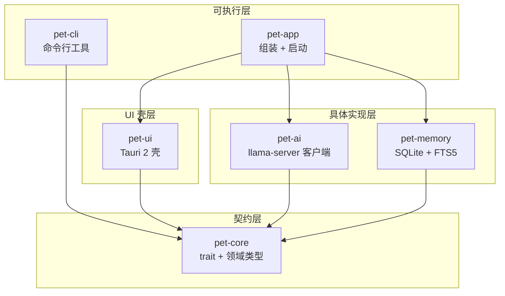

### 1. 完整目录树

```text
desktop-pet/
├── .env.example
├── .gitignore
├── Cargo.toml
├── README.md
├── rust-toolchain.toml
│
├── apps/
│   ├── pet-app/
│   │   ├── Cargo.toml
│   │   └── src/
│   │       └── main.rs
│   └── pet-cli/
│       ├── Cargo.toml
│       ├── src/
│       │   └── main.rs
│       └── tests/
│           └── cli.rs
│
├── crates/
│   ├── pet-ai/
│   │   ├── Cargo.toml
│   │   └── src/
│   │       ├── lib.rs
│   │       └── sse.rs
│   ├── pet-core/
│   │   ├── Cargo.toml
│   │   └── src/
│   │       ├── lib.rs
│   │       ├── error.rs
│   │       ├── types.rs        
│   │       ├── traits.rs       
│   │       └── mocks.rs
│   ├── pet-memory/
│   │   ├── Cargo.toml
│   │   └── src/
│   │       ├── lib.rs
│   │       └── sqlite.rs
│   └── pet-ui/
│       ├── Cargo.toml          # 可选，用于 workspace 跳转
│       ├── index.html          # 符合 Tauri 2 的标准前端布局
│       ├── package.json
│       ├── vite.config.ts
│       ├── src/                # 前端源码与静态资源
│       │   ├── main.js
│       │   ├── style.css
│       │   └── public/
│       │       └── pet/
│       │           └── idle.png
│       └── src-tauri/          # Tauri 2 Rust 后端
│           ├── Cargo.toml
│           ├── build.rs
│           ├── tauri.conf.json
│           ├── capabilities/
│           │   └── default.json
│           ├── icons/
│           │   ├── 32x32.png
│           │   ├── 128x128.png
│           │   ├── 128x128@2x.png
│           │   └── icon.png
│           └── src/
│               ├── lib.rs
│               └── main.rs
```

---

### 2. 根目录 `Cargo.toml`

```toml
[workspace]
members = [
    "crates/pet-core",
    "crates/pet-ai",
    "crates/pet-memory",
    "crates/pet-ui/src-tauri",
    "apps/pet-app",
    "apps/pet-cli",
]
resolver = "2"

[workspace.package]
version = "0.1.0"
edition = "2021"
license = "MIT OR Apache-2.0"
rust-version = "1.78"

[workspace.dependencies]
pet-core   = { path = "crates/pet-core" }
pet-ai     = { path = "crates/pet-ai" }
pet-memory = { path = "crates/pet-memory" }
pet-ui     = { path = "crates/pet-ui/src-tauri" }

# 异步与并发
tokio = { version = "1", features = ["rt-multi-thread", "macros", "time", "sync", "process", "fs"] }
futures-util = "0.3"

# 序列化
serde = { version = "1", features = ["derive"] }
serde_json = "1"

# 错误与日志
thiserror = "2"
anyhow = "1"
tracing = "0.1"
tracing-subscriber = { version = "0.3", features = ["env-filter"] }
async-trait = "0.1"

# 时间与 ID
chrono = { version = "0.4", features = ["serde"] }
uuid = { version = "1", features = ["v4", "serde"] }

# HTTP 客户端 (用于 llama-server)
reqwest = { version = "0.12", features = ["json", "stream", "rustls-tls"], default-features = false }

# 本地存储
rusqlite = { version = "0.32", features = ["bundled", "chrono", "serde_json"] }

# Tauri
tauri = { version = "2", features = [] }
tauri-build = { version = "2", features = [] }
```

---

### 3. `README.md`

# Desktop Pet (Rust + Tauri 2)

一个用 Rust 后端与 Tauri 2 构建的跨平台桌面宠物，支持命令行交互、透明置顶桌宠展示以及通过本地 `llama-server` 接入大模型智能对话和持久化记忆。

## 能力档位

- **一档（CLI 内核）**：提供 `pet-cli`，支持 `chat`、`memory list`、`state`，输出 JSON 以便被上层复用。
- **二档（透明桌宠）**：提供 Tauri 2 透明置顶窗口，支持拖拽移动、点击互动、三态动画（idle/happy/talking）、输入框聊天，气泡实时渲染流式回复。
- **三档（智能对话 + 记忆）**：后端接入本地 `llama-server` 进行流式对话，对话记录持久化到 SQLite，并在聊天前通过 FTS5 全文检索召回历史上下文。

## 架构与依赖



| Crate          | 职责                                                         | 依赖                                                  |
| -------------- | ------------------------------------------------------------ | ----------------------------------------------------- |
| **pet-core**   | 定义所有对外 trait（`ChatProvider`, `MemoryStore` 等）和领域类型。不含 IO 与平台代码。 | `serde`, `thiserror`, `async-trait`, `chrono`, `uuid` |
| **pet-ai**     | 实现 `LlamaServerChatProvider`（流式 SSE 解析）与 `MockChatProvider`。 | `pet-core`, `reqwest`, `eventsource-stream` 等        |
| **pet-memory** | 实现 `SqliteMemoryStore`（SQLite + FTS5 全文检索、持久化）。 | `pet-core`, `rusqlite` 等                             |
| **pet-ui**     | Tauri 2 透明置顶窗口，持有 `Arc<dyn Trait>` 并处理 IPC 通信。 | `pet-core`, `tauri`, `tokio`                          |
| **pet-app**    | 组合根，实例化上述实现并注入 `pet-ui` 启动。                 | 所有内部 crate                                        |
| **pet-cli**    | 命令行验证工具。                                             | `pet-core`                                            |

## 运行前置条件

1. **Rust stable**：`rustup default stable`
2. **Tauri 2 系统依赖**（Ubuntu/Debian）：
   ```bash
   sudo apt update && sudo apt install -y \
     build-essential pkg-config libssl-dev \
     libwebkit2gtk-4.1-dev libgtk-3-dev \
     libayatana-appindicator3-dev librsvg2-dev \
     libxdo-dev libasound2-dev
   ```
3. **llama-server**（可选，不装会自动降级 Mock）：
   确保你的 `llama-server` 运行在 `9931` 端口，并开启了 OpenAI 兼容 API：
   ```bash
   llama-server -m /path/to/model.gguf --port 9931
   ```
   

## 运行方式

### 1. 命令行工具
```bash
cargo run -p pet-cli -- chat "你好"
cargo run -p pet-cli -- memory list
cargo run -p pet-cli -- state
```

### 2. 桌面宠物 (Tauri Dev)
需要先安装前端依赖和 Tauri CLI：
```bash
# 安装 tauri-cli
cargo install tauri-cli

# 安装前端依赖并启动
cd crates/pet-ui
npm install
cargo tauri dev
```
*(注意：开发模式下 Tauri 依赖 Vite Dev Server，`cargo tauri dev` 会自动帮你拉起 Vite。)*

### 3. 运行全量测试
```bash
cargo test --workspace
```

## 如何切换到 Mock 模式

本项目内置了自动降级机制。**如果你没有启动 `llama-server`**，`pet-app` 启动时会探测 `127.0.0.1:9931`。如果连接失败，会自动降级使用 `MockChatProvider`（并在前端气泡中提示“当前为 mock 模式”），此时你依然可以完整体验气泡流式打字、拖拽、记忆存储等所有前端功能。

如果 `llama-server` 运行在其他端口，可以通过环境变量修改：
```bash
LLAMA_SERVER_PORT=8080 cargo run -p pet-app
```

### 4. `.gitignore`

```gitignore
# Rust
/target/
**/*.rs.bk
*.pdb

# Frontend
node_modules/
dist/
.vite/

# Env
.env
.env.*
!.env.example

# SQLite 数据
*.db
*.db-shm
*.db-wal
*.sqlite
*.sqlite3
rust-pet/

# Tauri 生成目录
src-tauri/target/
src-tauri/gen/

# IDE / OS
.vscode/
.idea/
*.swp
.DS_Store
```

---

### 5. `rust-toolchain.toml`

```toml
[toolchain]
channel = "stable"
components = ["rustfmt", "clippy"]
```

---

### 6. `.env.example`

```env
# llama-server 端口配置（如果未启动该服务，应用会自动降级为 Mock 模式）
LLAMA_SERVER_PORT=9931

# 语音引擎（当前支持 silence 静音模式，未来扩展）
PET_TTS_ENGINE=silence

# Rust 日志级别
RUST_LOG=info
```
